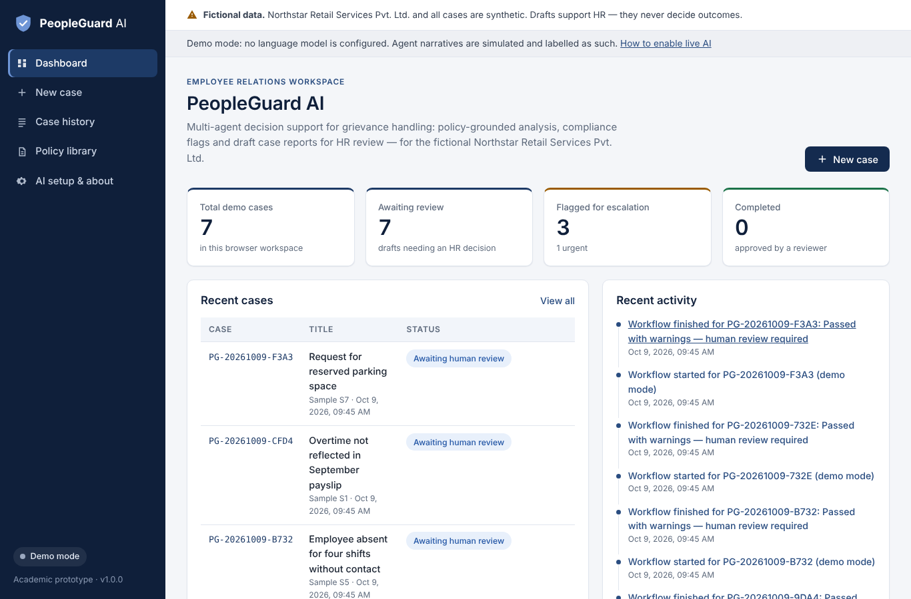
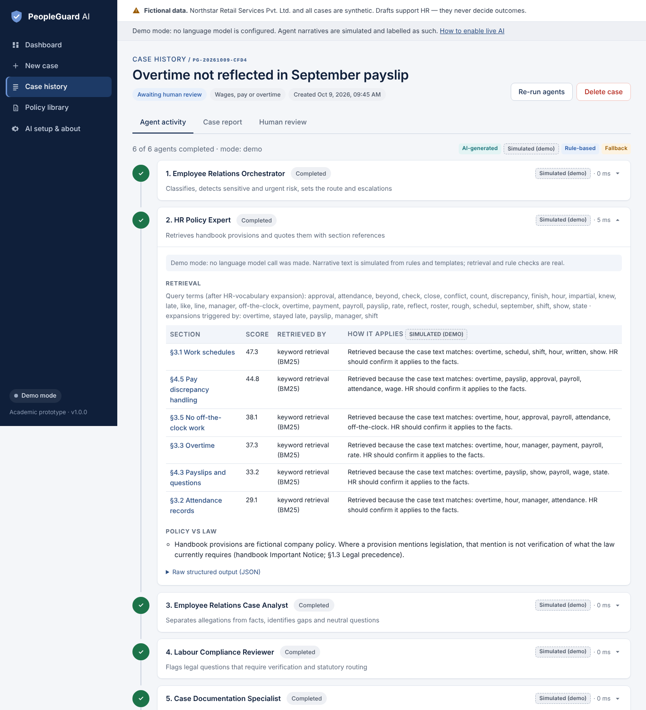
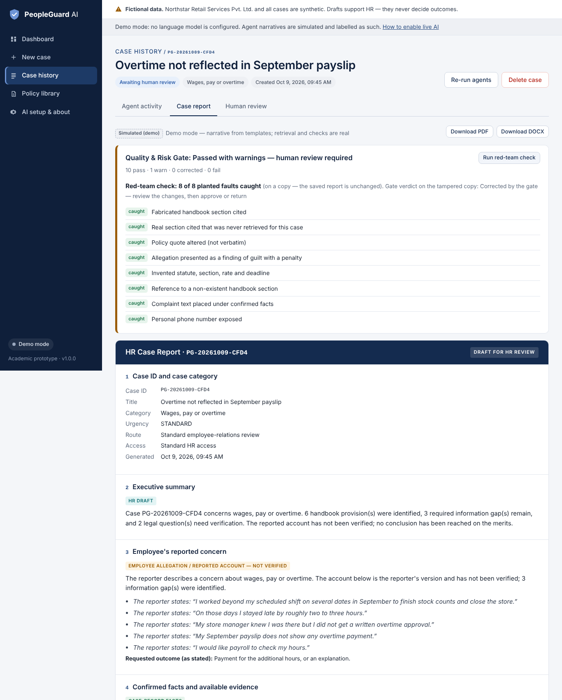
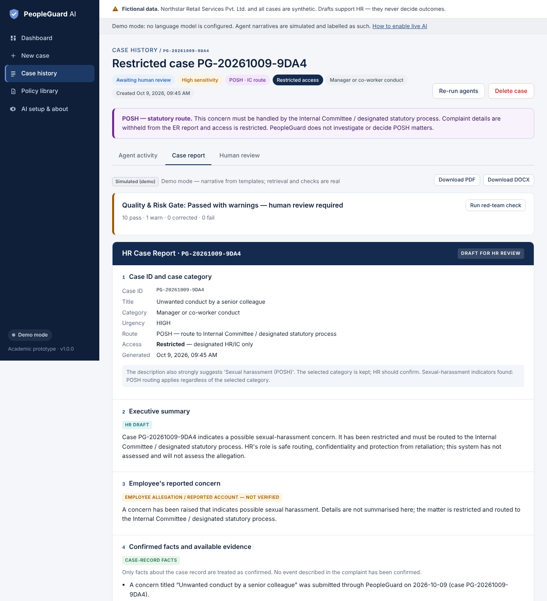
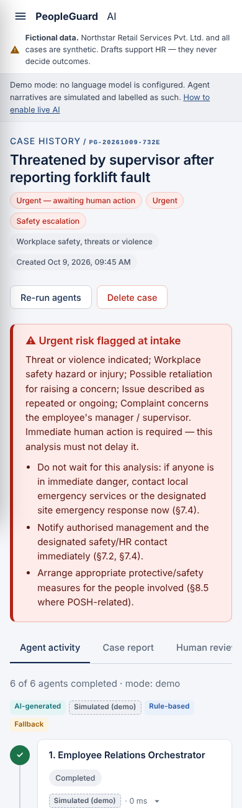

# PeopleGuard AI

**A multi-agent AI system for employee relations, grievance management and HR policy compliance.**
It is an academic prototype for the fictional company **Northstar Retail Services Pvt. Ltd.** (India).

PeopleGuard takes an employee grievance and works through it in stages:

- It finds the relevant provisions in a company HR handbook.
- Five specialist agents and a quality gate analyse the case.
- It flags compliance questions that need verification and routes sensitive cases (POSH, threats) correctly.
- It produces an evidence-grounded **draft** HR case report for a human reviewer.

> ⚠️ **Fictional data, decision support only.** Northstar, its handbook and every case here are synthetic. PeopleGuard never decides guilt, imposes discipline, terminates employment or replaces a legally required investigation or statutory committee. Every report is a draft that an authorised human must review.



---

## Contents

1. [What it does](#what-it-does)
2. [Quick start (local)](#quick-start-local)
3. [Enabling live AI (free options)](#enabling-live-ai-free-options)
4. [Deploying free on Render](#deploying-free-on-render)
5. [Running the tests and the evaluation](#running-the-tests-and-the-evaluation)
6. [Project structure](#project-structure)
7. [Security and privacy](#security-and-privacy)
8. [Known limitations](#known-limitations)
9. [Documentation](#documentation)

---

## What it does

| Stage | Agent | What it produces |
|---|---|---|
| 1 | **Employee Relations Orchestrator** | A case ID and category. It detects POSH, threats, self-harm, retaliation and safety risks **at intake**, then sets the route (standard / POSH-IC / urgent) and the escalations. |
| 2 | **HR Policy Expert** | Retrieves handbook sections (BM25 plus HR-vocabulary expansion), quotes them **verbatim** with section references, and reports "no evidence" instead of inventing policy. |
| 3 | **ER Case Analyst** | Keeps reported allegations separate from case-record facts and unauthenticated documents. It lists missing information, writes neutral follow-up questions and notes conflicts of interest. |
| 4 | **Labour Compliance Reviewer** | Names legal frameworks **only from the handbook's own legal reference map**, marks every point *requires verification*, lists the facts needed (location, category, dates) and decides on Legal escalation. |
| 5 | **Case Documentation Specialist** | Assembles the 12-section draft report, an evidence checklist, next steps and the responsible HR functions. |
| 6 | **Quality & Risk Gate** | Runs 11 independent checks: citation grounding, verbatim quotes, invented section numbers or law, allegation-as-fact and guilt/penalty language, missing information, escalation consistency, personal data and injected instructions. It **corrects, warns or blocks**, and every case still needs human approval. |

The app's pages:

- **Dashboard**: live counts from the case data.
- **New case**: intake form with sample loader and document upload.
- **Agent activity**: an expandable output panel for each agent, with *AI-generated / Simulated / Rule-based / Fallback* labels.
- **Case report**: PDF and DOCX download, plus a *red-team* button that plants faults and shows the gate catching them.
- **Human review**: approve or return the draft.
- **Policy library**: search, section browser and re-index.
- **Case history**: filter and delete cases.
- **AI setup**: page explaining how to enable live AI.

## Quick start (local)

You need **Python 3.11 or newer** (tested on 3.12 and 3.13).

```bash
git clone https://github.com/<your-username>/PeopleGuard-AI.git
cd PeopleGuard-AI
python -m venv .venv
# Windows: .venv\Scripts\activate      macOS/Linux: source .venv/bin/activate
pip install -r requirements.txt
cp .env.example .env            # optional; Windows: copy .env.example .env
uvicorn app.main:app --reload
```

Open <http://localhost:8000> and click **Load and run all 7 demo cases**. No API key is needed: the app starts in **demo mode**.

The policy handbook `data/policies/PeopleGuard_Fictional_HR_Policy_Book_India.docx` is included and is indexed automatically when the app starts.

### What "demo mode" means

The following parts are **real computations in every mode**: retrieval, triage, routing, escalation rules, missing-information checks, citation checks and the Quality & Risk Gate.

Without a language model, the *wording* of summaries and "how this applies" notes comes from templates. Everything written that way is labelled **Simulated (demo)** in the interface. The app never presents simulated text as AI output.

## Enabling live AI (free options)

Set two environment variables (in `.env` locally, or in the Render dashboard) and restart the app:

```bash
LLM_PROVIDER=gemini
GEMINI_API_KEY=your-key
```

| `LLM_PROVIDER` | Key variable | Free allowance (check before relying on it; limits change) |
|---|---|---|
| `gemini` (recommended) | `GEMINI_API_KEY` from Google AI Studio | Free tier with per-model limits on requests per minute and per day. Free-tier prompts may be used by Google to improve its products, so use synthetic data only. Default model `gemini-2.5-flash`. |
| `groq` | `GROQ_API_KEY` | Free plan: about 30 requests/minute and about 1,000/day per model, with a low tokens-per-minute cap. Default model `openai/gpt-oss-120b`. |
| `openrouter` | `OPENROUTER_API_KEY` | Models ending in `:free`: about 20 requests/minute and 50/day without credit. |
| `openai_compatible` | `LLM_BASE_URL` (+ optional `OPENAI_COMPATIBLE_API_KEY`) | Any OpenAI-style server, e.g. a local [Ollama](https://ollama.com) at `http://localhost:11434/v1`. Free, runs on your machine. |

Each case makes **six** model calls, one per agent. `LLM_MIN_INTERVAL_SECONDS` (default 2) spaces them out to respect per-minute limits.

If a call fails, the app handles it as follows:

- A rate limit, timeout or malformed reply is retried.
- If the call still fails, that agent falls back to rule-based output and is clearly marked **Fallback**.

Model output is always:

- validated against a schema;
- limited to citing sections that were actually retrieved;
- re-checked by the gate.

A model can **add** safety flags but can never remove one, downgrade urgency or move a POSH case out of the Internal Committee route.

> The live-AI path is covered by automated tests against a *mocked* provider (`tests/test_llm_mode.py`). It has **not** been run against a real model in the build environment, so test it once with your own key before a demonstration.

## Deploying free on Render

1. Push this repository to GitHub (see below).
2. On <https://render.com> choose **New → Blueprint** and select the repository. Render reads `render.yaml` and creates a free web service.
3. Optionally add `GEMINI_API_KEY` (and change `LLM_PROVIDER` to `gemini`), `APP_ACCESS_CODE` (recommended) and `ADMIN_TOKEN` in the service's **Environment** tab.
4. Open the service URL. `/health` should report `"status": "ok"`.

Notes on the free tier:

- The service sleeps when idle, so the first request after a sleep takes a while.
- The disk is temporary: cases are wiped on redeploy or restart. This suits a demo, but it is not durable storage.
- No Docker is needed.

### Pushing to GitHub

```bash
git init            # skip if the folder is already a repository
git add .
git commit -m "PeopleGuard AI"
git branch -M main
git remote add origin https://github.com/<your-username>/PeopleGuard-AI.git
git push -u origin main
```

`.gitignore` already excludes `.env`, local databases and caches.

## Running the tests and the evaluation

```bash
pip install -r requirements-dev.txt
python -m pytest -q                          # automated tests
python scripts/evaluate.py --with-tests      # rewrites docs/EVALUATION.md from a real run
# or: scripts/run_tests.sh  (Windows: scripts\run_tests.bat)
```

The tests cover:

- health endpoint and pages;
- policy extraction and retrieval;
- case creation and invalid input;
- agent output structure;
- every Quality-gate check;
- missing-API-key behaviour;
- missing policy evidence;
- POSH, urgent and retaliation escalation;
- PDF/DOCX report generation;
- workspace isolation;
- access code;
- live-AI behaviour with a mocked provider (valid, malformed, schema-mismatch, rate-limited, bad key);
- all seven sample cases against their documented expectations.

See [docs/EVALUATION.md](docs/EVALUATION.md) for the latest measured results, **including the cases the system gets wrong**.

## Project structure

```
PeopleGuard-AI/
├── app/
│   ├── main.py                  # FastAPI app, workspace cookie, access code
│   ├── config.py                # environment-variable settings (no secrets in code)
│   ├── api/routes.py            # JSON API
│   ├── api/pages.py             # HTML pages
│   ├── agents/                  # orchestrator, policy_expert, er_case_analyst,
│   │                            # compliance_reviewer, documentation_specialist, quality_gate, base
│   ├── retrieval/               # handbook_parser.py (DOCX/PDF/TXT → sections), index.py (BM25)
│   ├── services/                # llm.py (providers), rules.py (safeguards), workflow.py,
│   │                            # documents.py, report_export.py (PDF/DOCX), stress_test.py
│   ├── models/schemas.py        # input and LLM-output schemas
│   ├── storage/db.py            # SQLite
│   ├── templates/               # Jinja2 pages
│   └── static/                  # CSS, JavaScript, icon
├── data/
│   ├── policies/PeopleGuard_Fictional_HR_Policy_Book_India.docx
│   └── sample_cases/            # 7 sample cases + expected behaviour, 14 evaluation variants
├── tests/                       # pytest suite
├── scripts/                     # evaluate.py, run_tests.sh/.bat, run_local.sh
├── docs/                        # ARCHITECTURE, USER_GUIDE, AGENT_DESIGN, EVALUATION, screenshots
├── requirements.txt, requirements-dev.txt, .env.example, .gitignore, render.yaml, LICENSE
```

## Security and privacy

- **API keys** are read only from server environment variables. They are never sent to the browser, stored or logged, and error messages are scrubbed of them.
- **Case isolation.** Each browser gets a random workspace cookie and only sees its own cases. This is **isolation, not authentication**.
  - For a shared deployment, set `APP_ACCESS_CODE` so that visitors must enter a code.
  - This is not a secure production HR system. Use synthetic data only.
- **POSH cases** are restricted:
  - complaint details are withheld from the ER report;
  - titles are hidden in lists;
  - the report routes the case to the Internal Committee.
- **Personal data minimisation.** Phone numbers, emails, Aadhaar-like, PAN-like and account-like numbers are redacted before text reaches a model and from reports.
- **Uploaded documents are data, not instructions.** They are wrapped as untrusted in prompts and are not used to steer retrieval. Instruction-like text is flagged.
- **Replacing the handbook** affects everyone, so it requires `ADMIN_TOKEN`.

## Known limitations

- Sensitive-case detection is pattern-based and can miss indirect descriptions. The evaluation includes a fresh held-out POSH case that it misses. Staff should select the POSH category whenever they suspect harassment.
- Retrieval is lexical. It is fast and explainable, but wording far from the handbook's vocabulary can retrieve weaker sections.
- There is no live legal research. Every legal point is "requires verification" by design.
- The evaluation set is small, synthetic and written by the project author.
- On Render's free tier the database is temporary.

## Documentation

- [docs/ARCHITECTURE.md](docs/ARCHITECTURE.md): components, data flow, retrieval design and technology choices
- [docs/AGENT_DESIGN.md](docs/AGENT_DESIGN.md): each agent's instructions, inputs, outputs and guardrails
- [docs/USER_GUIDE.md](docs/USER_GUIDE.md): step-by-step walkthrough for a demonstration
- [docs/EVALUATION.md](docs/EVALUATION.md): measured results (generated by `scripts/evaluate.py`)

### Screenshots

The screenshots in `docs/screenshots/` were captured from the running app in demo mode. To refresh them, run the app, load the demo cases and take browser screenshots of each page. Any browser's full-page screenshot tool works.

| Agent activity | Case report with red-team check | POSH routing | Mobile (urgent case) |
|---|---|---|---|
|  |  |  |  |

---

*Academic project: PGDM (Big Data Analytics) individual assignment on domain-expert AI agents for a business process.*
