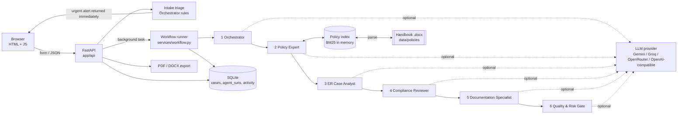

# Architecture

PeopleGuard AI is one small Python web service. It has no microservices, no vector database and no Docker, so it runs unchanged on a laptop or a free hosting tier.

## Components

| Layer | Files | Responsibility |
|---|---|---|
| Web | `app/main.py`, `app/api/pages.py`, `app/templates/`, `app/static/` | Server-rendered pages with vanilla JavaScript. The middleware assigns each browser a random workspace cookie and enforces the optional access code. |
| API | `app/api/routes.py` | Case CRUD, workflow start/re-run, review, report export, red-team test, policy search/re-index/upload, health. |
| Agents | `app/agents/*.py` | Six agents built on one base class (`base.py`). Each has its own instructions, output schema, deterministic rules, demo-mode narrative and LLM merge logic. |
| Workflow | `app/services/workflow.py` | Runs the agents in order and records the status, mode, timing and output of each. It skips downstream agents if a required upstream agent fails and never marks an agent completed unless it ran. |
| Retrieval | `app/retrieval/handbook_parser.py`, `index.py` | Turns the handbook into citable sections and serves BM25 search. |
| Safeguards | `app/services/rules.py` | Sensitive-case patterns, urgency, required records, PII redaction, injection detection, and the guilt/allegation/legal-specific patterns used by the gate. |
| LLM | `app/services/llm.py` | Provider-agnostic JSON completion over HTTPS. Handles retries, rate limits, pacing and malformed output, and scrubs secrets. |
| Storage | `app/storage/db.py` | SQLite with three tables. Every query is scoped to a workspace. |
| Export | `app/services/report_export.py` | One section model rendered to DOCX (python-docx) and PDF (reportlab). |

## Request flow for a new case

1. `POST /api/cases` validates the form (Pydantic) and extracts text from any uploaded PDF/DOCX/TXT (size and type limits apply).
2. **Intake triage runs synchronously** (`orchestrator.triage`). It covers category inference, sensitive flags, urgency, route, escalations and restricted access.
3. The case is stored and the response returns straight away with any **urgent actions**. The UI shows them before the agents finish, so emergency action is never delayed by the analysis.
4. The six-agent workflow runs as a background task. The case page polls `/api/cases/{id}` and updates each agent card live.
5. The Quality & Risk Gate's corrected report becomes the saved report. The case status becomes *awaiting review*, or *urgent — awaiting human action*.
6. A reviewer approves or returns the draft. A draft that the gate blocked cannot be approved.

## Policy retrieval design (RAG)

**Extraction.** `handbook_parser.parse_docx` walks the DOCX body in document order, covering both paragraphs and tables:

- *Heading 1* and *Heading 2* styles define sections. Numbers are taken exactly as printed (`3.3`, `14`, `Appendix C`); none are invented.
- Each table row becomes its own citable chunk. For example, the escalation table yields `§14 … (row: Payroll / Benefits)` and the legal reference map yields `Appendix C … (row: Sexual harassment at workplace)`.
- PDF, TXT and Markdown handbooks are parsed using numbered headings.

**Evidence vs reference.** Some sections are visible in the Policy Library but are never used as case evidence:

- Contents, Document Control, Version History and the Important Notice.
- Appendix A (AI rules). These are built into every agent's instructions instead.
- Appendix B (the handbook's example cases). Excluding them stops the evaluation from simply retrieving the expected answers.
- The official sources list, which the Compliance Reviewer uses as "where to verify" pointers.

**Search.** BM25 (`k1=1.4, b=0.6`) over heading + parent heading + text, with:

- a small stemmer and stop-word lists (including HR-generic words such as *employee*, *policy*);
- an **HR vocabulary expansion table** that maps complaint language to handbook terms (e.g. *stayed late → overtime, hours, attendance*; *shouted, humiliated → respectful conduct, humiliating*). Keys match at word starts only;
- category terms from the (possibly inferred) grievance category;
- an absolute threshold (`RETRIEVAL_MIN_SCORE`, default 6.0) and a relative floor (20% of the best hit). Below these, the system reports **no relevant evidence** instead of returning weak matches;
- **routing-rule inclusions**: POSH cases always include §8.2–8.4, urgent cases §7.4/§7.2, and complaints about a manager §9.6. Each is labelled "routing rule".

Uploaded documents are **not** used as retrieval queries. They are untrusted input, so the grievance text alone drives retrieval.

**Why not embeddings or a vector database?** The corpus is about 90 short sections. BM25 builds in milliseconds, needs no model download or external API, works on any free tier, and its scores are explainable to an evaluator (the matched terms are shown). Paraphrases with no shared vocabulary are the main weakness; the evaluation report lists where it happens. Swapping in embeddings would only touch `index.py`.

**Grounding checks.** Every cited `chunk_id` must exist and must be among the passages retrieved for that case. Quotes are chosen verbatim from the section (non-adjacent sentences are joined with "…"), and the gate re-verifies each fragment against the source text.

## Live AI vs demo mode

Each agent has three parts:

1. `rules()`: deterministic analysis that always runs.
2. `simulate()`: template narrative for demo mode, labelled *Simulated*.
3. `build_prompt()` + `merge()`: in live mode, the agent asks the model for a JSON object that must validate against a Pydantic schema (`models/schemas.py`), then merges it with guardrails:
   - citations are restricted to retrieved IDs;
   - legal frameworks are restricted to Appendix C rows;
   - the model can add flags, escalations or concerns but never remove them;
   - POSH complaint details are never re-introduced.

If the model fails after retries, the agent's status is **fallback**: its output is the rule-based version, labelled as such, and the gate warns the reviewer.

## Storage

| Table | Contents |
|---|---|
| `cases` | Input, triage, documents (extracted text), final report, gate summary, review history, status, workspace |
| `agent_runs` | One row per agent per case: status, mode (llm / simulated / rules), timings, model, attempts, full structured output, notes, error |
| `activity` | Event log shown on the dashboard |

Dashboard counts are SQL aggregates over `cases` for the current workspace. Nothing is hard-coded.

## Technology choices

| Need | Choice | Reason |
|---|---|---|
| Backend | FastAPI + Uvicorn | Typed validation, background tasks, automatic API docs at `/api/docs` |
| Frontend | Jinja2 + vanilla JS + CSS | No build step; easy to read and change |
| Retrieval | Own BM25 (≈150 lines) | Zero dependencies, explainable, free-tier friendly |
| LLM | Plain HTTPS via httpx | No vendor SDKs; switching provider is a configuration change |
| Database | SQLite | Built into Python; adequate for a demo |
| Export | python-docx, reportlab | Pure Python; no system packages needed on Render |
| Deployment | Render Blueprint (`render.yaml`) | Free web service, health check, secrets entered in the dashboard |
